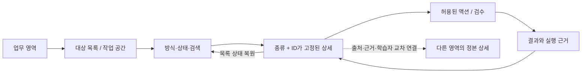

# 관리자 하위 메뉴·파이프라인 재설계안

> 최종 수용(2026-10-20): 7개 상위·22개 하위·89개 페이지 소속 정리와 후속 주문 계보 연결을 구현했다. 실제 프로덕션 인증/DB에서 통제된 합성 계정의 네 계보 상태 화면과 23개 메뉴 목적지를 검증하고 계정/권한·주문·Workspace를 종료했다. [최종 구성·기존 대비·실행 결과](admin-restructure/final-acceptance.md). 아래 설계 제안은 당시의 비교 자료다.

> 아래는 v2 조사·설계 당시 기록이다. 사용자 후속 지시로 적용한 현재 메뉴·업무 연결·검증·남은 Gap은 [v2.1 구현 기록](./admin-restructure/v21-delivery.md)을 참조한다.

2026-10-19 · **설계 제안, 미적용** · PC 관리자 웹

## 1. 권고안과 조사 범위

**상위 7개 업무 영역은 유지하고, 하위 메뉴는 지속적으로 관리하는 대상과 책임을 기준으로 재편한다.** 수집 방식은 방식 선택으로, 처리 상태는 목록 필터로, 실행 내역은 대상 상세로, 설정은 해당 업무의 설정 패널로 옮긴다. 처리 엔진·진단 체계·발행 게이트는 각 파이프라인에 남긴다.

현재 로컬 1차안은 상위 소속과 일부 연결을 정리한 구현이다. 이번 2차안은 그 아래의 목록·작업·상세·복귀·실행 경계를 다시 설계한 문서다. **1차안의 화면 코드를 교체하지 않았다. 커밋·push·PR·DB 변경도 하지 않았다.** 1차안의 구현·검증 기록은 [admin-restructure.md](./admin-restructure.md)를 참조한다.

비교 기준은 다음 세 가지다. 문서에 적힌 재고 수치를 운영 실측으로 재사용하지 않았다.

| 구분 | 기준 | 이 문서에서의 의미 |
|---|---|---|
| 기존 구성 | main에서 분기한 HEAD `fcb40034d43ccfbf1a429c76de97ed840d0bac5d`의 사이드바·페이지 | 조사 기준 스냅샷. 이후 원격 main 변경까지 포함한다는 뜻은 아님 |
| 로컬 1차안(v1) | 같은 HEAD 위에 미커밋으로 보존한 관리자 재구조화 | 실제 로컬 구현. 기존 검증 기록은 v1에만 적용 |
| 재설계안(v2) | 이 문서와 경로 명세 | 신규 탭·공통 조회·주문 결속은 제안이며 구현·운영 검증 전 |

조사 방법: 관리자 `page.tsx` **89개 전수 목록화**, 해당 페이지의 로컬 import를 깊이 4까지 추적한 **572개 코드 파일 정적 색인**, 주요 클라이언트·서버 액션·API·도움말·Factory 계약의 집중 독해다. 572개 전부의 모든 분기를 수동 검증했다는 뜻은 아니다. [소스 색인](./admin-restructure/source-inventory.json)에 파일별 해시·조회/API/액션 문자열을 남겼다. import 그래프 밖의 동적 호출, 배포된 스케줄러, 실제 데이터 분포, 처리 시간·운영자 사용 빈도는 확인하지 않았다. DB 읽기·쓰기를 실행하지 않았다.

상세 산출물:

- [파이프라인·프로세스 분석](./admin-restructure/pipeline-analysis.md): 입력 → 실행 주체 → 상태 → 검수 → 산출물 → 복구의 근거와 재설계 경계.
- [89개 전체 경로 이행표](./admin-restructure/route-map.md): 로컬 v1 소속과 v2 소속·보기·상세/호환 경로 보존.
- [기계 판독 설계 명세](./admin-restructure/submenu-plan.json): 기존 메뉴 소속·현재 소속·제안 소속·목적지·근거 파일.
- [액션·권한 경계](./admin-restructure/permission-contracts.md): 조사 범위의 서버 액션 모듈 24개·함수 선언 101개와 API/RPC 검사 위치·미확인 범위.
- `node scripts/admin/submenu-audit.mjs`: 실제 페이지 누락·중복 소속·없는 목적지·코드 스냅샷 변경을 검사한다. 설계의 사용성이나 운영 실행 성공을 증명하는 검사는 아니다.

## 2. 구조적 문제와 바꿀 이유

| 관찰 | 확인한 근거 | 영향 | 재설계 결정 |
|---|---|---|---|
| 자료 종류·생산 방식·공정 단계·연구 기준이 같은 탐색 층에 섞임 | 기존 사이드바, v1 `navigation.ts`, 각 클라이언트 탭 | 업무 대상보다 파이프라인 이름을 먼저 알아야 함 | 대상의 작업 공간 → 방식/상태 → 상세 순으로 배치 |
| 도서 입력 방식이 별도 작업 탭처럼 늘어남 | LCP 입력 8방식, v1 3개 보기 | 입력 방식과 수집 후 관리가 분리되기 쉬움 | v1의 목록/수집/검토 대기를 유지하고 입력 선택은 수집 안에 둠 |
| ACP와 Compose의 결과는 짧은 글이지만 저장·권리·사실 검수 계약이 다름 | ACP 콘솔, Compose 7탭·fact ledger·발행 액션 | 한 ‘수집·발행’ 버튼으로 합치면 전제와 실패 원인을 잃음 | 짧은 글 아래 두 방식 유지, 방식별 작업·검수 제공 |
| CCP와 PDCP는 책·스캔 호의 식별자와 통과 조건이 다름 | CCP QC RPC, PDCP 권리 근거·복원/OCR | 일반화한 만화 상태가 실제 차단 사유를 가림 | 만화 아래 디지털 제작/스캔 복원, typed ID와 개별 게이트 보존 |
| 주제 코퍼스가 콘텐츠 공급에 있지만 직접 결과는 어휘 관측·분류·누락 후보 | TCP enqueue/drain/promote, 도움말 | 원문을 학습자에게 발행하는 메뉴로 오인 가능 | 어휘·사전의 관측·분류로 이동 |
| 교재의 URL 선택 기준이 실제 주문별 조회로 이어지지 않음 | `authoring/page.tsx`, 인자 없는 `loadAuthorView()`/`loadExplainView()` | 선택한 한 권의 진척처럼 공장 전체 재고를 읽을 위험 | 당장은 ‘제작 공정’, 전체 재고 표시. 정본 주문 reader 연결 후에만 주문별 작업판 제공 |
| 학습자 진단·수준·이력이 공급 측 VRL 아래에서 출발 | VRL 사용자/스냅샷/진단 페이지 | 같은 학습자 업무가 서로 다른 메뉴에 분산 | 학습자 기록과 진단 운영으로 재배치, 영어/어휘 엔진은 분리 |
| 사용자 화면은 일부 집계와 목업 고지이며 완전한 CRM이 아님 | `users/page.tsx`의 `MockDataBanner` | 새 통합 기록이 이미 있는 것처럼 설계하기 쉬움 | 실데이터가 있는 진단 참여자부터 진입. 사용자 집계의 한계 유지 |
| 탐구 연구소는 9개 링크, 영상은 7탭에 업무·자산·평가·낡음이 혼재 | `WORKSPACES`, `VideoConsoleClient.tsx` | 목록·처리·설정의 책임이 불명확 | 연구는 질문/근거/검토에 묶고, 영상은 요청·제작/발행 영상/성과·점검으로 묶음 |
| ‘재시도’, ‘발행’, ‘회수’가 파이프라인마다 다른 효과 | LCP requeue 삭제 경로, 영상 retire sync, CCP 발행 RPC | 공통 버튼의 이름만 같아도 영향·복구는 다름 | 액션은 원래 도메인에 유지하고 대상·범위·부작용·실행 주체를 표시 |
| 기출 첫 화면·우선순위가 관리자 본인의 학습 이력을 함께 조회함 | `kice/page.tsx`의 내 기록 칩, `kice/plan/page.tsx`의 `loadCsatPlan(scope)` + `loadMyTraps(db)` | 공용 출제 분석과 개인 학습 계획의 의미가 섞임 | 두 화면 모두 공용 분석을 기본으로 하고 개인화는 명시한 학습자 문맥에서만 제공 |

근거 파일의 세부 동작은 [프로세스 분석 P01–P18](./admin-restructure/pipeline-analysis.md)에 연결했다. 위 영향은 코드로 확인한 책임 혼재에 대한 설계 판단이다. 실제 운영자가 몇 번 실수했는지, 처리 시간이 얼마나 줄어드는지는 측정하지 않았다.

## 3. 기존·1차안·재설계 비교

원래 사이드바는 **7개 그룹 머리글, 직접 링크 30개, 펼침 자식 링크 28개**였다. 한 번에 모두 보인다는 의미는 아니다. v1과 v2의 하위 수는 사이드바 링크 수가 아니라 **영역 안의 2차 작업 공간** 수다. 따라서 30→7이나 58→22를 같은 층의 감축률로 사용하지 않는다. 같은 층인 v1→v2의 하위 공간은 26→22다.

| 업무 | 기존 구성 | 로컬 v1 | v2 제안과 달라지는 책임 |
|---|---|---|---|
| 홈 | 대시보드 | 작업 홈 | 처리할 일·최근 변경을 조회로 연결. 재고·시도·게이트 실패를 중복 합산하지 않음 |
| 콘텐츠 | 콘텐츠/도서 수집/짧은 글/사실 재저작/만화/스캔 만화/코퍼스 | 도서/짧은 글/만화/코퍼스 **4** | 도서/짧은 글/만화 **3**. 코퍼스는 어휘로 이동 |
| 교재 | 교재 공장 아래 공정·연구·용어·숫자 13개 자식 | 제작 현황/한 권 만들기/발행 교재 **3** | 제작 현황/제작 공정/발행 교재 **3**. 실제 주문과 탐색 기준을 구분 |
| 어휘 | 단어장 마스터/어휘 빌드/VRL 및 6개 자식/대기 단어 | 사전/단어장 제작/사전 보강/품질·분류 **4** | 사전/단어장/사전 보강/관측·분류 **4**. TCP 유입, 진단·수준은 학습자 책임 |
| 학습자 | 운영의 사용자/플랫폼 분석, 교재의 진단, VRL의 진단·사용자·이력 | 사용자/영어 진단/어휘 진단·수준/활동 분석 **4** | 학습자 기록/진단 운영/활동 분석 **3**. 대상 기록과 검사 운영 분리 |
| 연구 | 원리 운영실·지도·연구소·설계·적용, 교재 아래 기출·비교·설계 | 기존 5공간+기출 분석+교재 기준 **7** | 연구 현황/탐구·근거/기출 분석/역량·원리/설계·검증/적용·성과 **6**. 교재 기준을 설계 안으로 |
| 운영 | 영상/신고/결제 + 품질/게이트/판정/DB/설정 | 콘텐츠 품질/DB 상태/홍보 영상/연결·지원 **4** | 품질·실행/DB 점검/홍보 영상 **3**. 연결 상태는 정보 패널, 실제 판정·검사 실행은 작업으로 유지 |

대안도 비교했다.

| 대안 | 장점 | 적용하지 않는 이유 / 채택 범위 |
|---|---|---|
| 파이프라인 약어별 메뉴 | 엔진과 코드 위치가 바로 대응 | 운영자가 LCP/ACP/CCP/TCP 등의 차이를 먼저 학습해야 함. 상세의 실행 방식 설명에만 사용 |
| 수집→가공→검수→발행을 전역 메뉴로 배치 | 순서는 읽기 쉬움 | 진단·연구·관측·DB에 동일 선형 공정을 강요하고 한 자료의 상태가 여러 메뉴에 흩어짐. 각 대상 상세의 공정 표시에만 사용 |
| **대상·책임별 공간 + 내부 방식 + 대상별 공정** | 안정된 진입점과 엔진 경계가 공존 | 공통 목록이 필요한 곳에는 읽기 어댑터가 필요. 기존 목록부터 연결하고 단계적으로 확장하는 권고안 |

## 4. 제안 메뉴 트리와 탐색 규칙

```text
작업 홈
콘텐츠
  도서 / 짧은 글 / 만화
교재 제작
  제작 현황 / 제작 공정 / 발행 교재
어휘·사전
  사전 / 단어장 / 사전 보강 / 관측·분류
학습자·진단
  학습자 기록 / 진단 운영 / 활동 분석
연구·기준
  연구 현황 / 탐구·근거 / 기출 분석 / 역량·원리 / 설계·검증 / 적용·성과
운영·시스템
  품질·실행 / DB 점검 / 홍보 영상
```

같은 목적의 행을 반복해서 쌓지 않는다. 상위는 업무 영역, 하위는 현재 대상의 공간, 작업면은 선택 대상의 공정이다. 목록 필터와 대상 상세를 모두 전역 메뉴처럼 표시하지 않는다.



설정 진입은 해당 방식 옆의 이름 있는 ‘소스 설정’, ‘엔진 버전’ 등으로 제공한다. 중요한 활성 작업을 설정 안에 감추지 않는다. 특히 추출 판정과 품질 검사 실행은 명시적으로 접근 가능한 작업이다. 기술 용어집은 도움말, 연결·지원 상태는 정보 패널이지만 옛 URL은 유지한다.

## 5. 메뉴별 하위 화면 설계

### 5.1 작업 홈

목적은 ‘무엇을 먼저 처리하고 어디로 이동할지’ 판단하는 것이다. 전체 재고 대시보드나 모든 엔진의 실행 콘솔을 새로 만들지 않는다.

| 구성 | 제안 동작 | 조건 |
|---|---|---|
| 처리할 일 | 검토 대기/실패/입력 필요/결과 확인을 원래 큐별로 보여주고 해당 필터로 이동 | 각 원천의 상태를 그대로 읽는 조회 어댑터 필요 |
| 최근 변경 | 확인 가능한 도메인별 이력 링크. 작성자·시각·대상·이력의 종류 표시 | 기록 없는 엔진은 ‘이력 미제공’, 임의 로그 생성 금지 |
| 실행 상태 | 대기·실행 중·완료·실패와 마지막 갱신, 실행 주체 표시 | 큐 등록 성공과 실제 실행 시작을 구별 |
| 즉시 작업 | 도서 수집, 단어장 제작, 진단 시험 검토 등 기존 진입 링크 | 실제 외부 드레인이 필요한 작업은 실행 주체를 명시 |

배지는 `종류+원천 ID+필요 작업`별 집계다. 같은 도서의 게이트 실패와 재시도 큐를 단순 합산해 ‘고유 콘텐츠 수’라고 표시하지 않는다. 부분 조회 실패 시 성공한 소스만 표시하고 실패 소스를 0건으로 바꾸지 않는다.

### 5.2 콘텐츠 — 3개 하위 메뉴

| 하위 메뉴 | 기존 내부 구성 | 재설계 내부 구성 | 주 액션·상세·복귀 |
|---|---|---|---|
| 도서 | 원래 소스 중심 탭 → v1 목록/수집/검토 대기, 수집 8방식 | **도서 목록 / 수집 / 검토 대기** 유지. 실행 내역은 도서 상세 | 수집 결과의 book ID로 상세. 목록 q/source/level/status/page/선택 및 페이지 밖 선택 계약 보존 |
| 짧은 글 | ACP 커버리지/GET/검수/게시 + Compose 소스/피드/발견/원장/작성/가공/발행 | 방식 **원문 수집 / 사실 재저작**. ACP 4보기 유지·명칭 정리. Compose는 **자료 / 사실 검증 / 작성·가공 / 검토·발행** | ACP는 article ID, Compose는 batch→job→article의 연결로 이동. 방식 전환 시 다른 방식의 status를 전달하지 않음 |
| 만화 | CCP Catalog/Published/스타일/테스트/모델 + PDCP 소스/큐/PD근거/테스트/도구 | 방식 **디지털 제작 / 스캔 복원**. 각 방식에 **작업 목록 / 처리 / 검수·발행**. 모델·스타일·소스는 방식 설정, 테스트는 실행 상세 | CCP book ID와 PDCP issue ID 구별. 목록 복귀와 원문/페이지 미리보기 유지 |

**도서:** 소스 선택을 마친 뒤 결과를 다시 다른 메뉴에서 찾지 않도록, 수집 성공 시 새로 생긴 대상과 중복·실패 결과를 보여준다. 일괄 작업은 선택한 ID 수와 보호 대상·제외 사유를 나눈다. 삭제 후 재수집 경로는 단순한 ‘재시도’로 표기하지 않는다. 검토 대기 진입/이탈에서 v1이 명시한 상태·페이지 초기화를 유지한다.

**짧은 글:** 원문 수집과 사실 재저작을 같은 저장·발행 규칙으로 묶지 않는다. Compose의 소스·피드 관리는 설정에, 발견 결과는 자료 목록에, 사실 카드와 attestation은 선택 batch의 사실 검증에 둔다. 발행 직전 source/article 계보와 해당 게이트를 표시한다. 여러 방식의 통합 발행 목록은 `kind+id`를 갖춘 조회가 추가된 이후 제공한다. 1단계에는 기존 두 목록을 방식 선택으로 연결한다.

**만화:** CCP의 Published 탭은 현재 draft·archived도 포함할 수 있어 ‘제작본’ 목록으로 이름을 맞추고 상태 필터를 둔다. PDCP의 PD 근거는 모든 스캔 호에 필요한 검수 항목이다. 도구나 전역 설정으로 옮기지 않는다. OCR 불필요와 OCR 실패를 구분하고, 탭에서 드레인을 반복하는 동안 창 종료가 어떤 영향을 주는지 표시한다. 만화의 화면 통합이 제작 엔진 통합을 의미하지 않는다.

### 5.3 교재 제작 — 3개 하위 메뉴

| 하위 메뉴 | 재설계 작업면 | 현재 가능한 범위 / 선행 조건 |
|---|---|---|
| 제작 현황 | 공정별 전체 재고·병목, 상세 수치 펼치기 | 기존 reader 재사용. 전체 재고라고 명시 |
| 제작 공정 | 제작 기준 → 글감 선택 → 지문 → 문항·해설 → 검수 → 발행 승인 | 현재는 탐색 기준 전달. 선택 범위에 결속된 reader가 없는 단계는 ‘전체 재고’ 표시 |
| 발행 교재 | 렌더/발행본 목록 → 권별 상세 → 검수·승인 계보 | 기존 render 및 gate 기준 유지. 승인 기록과 학습자 납품·노출을 같은 상태로 취급하지 않음 |

‘한 권 만들기’는 실제 저장된 주문을 끝까지 추적할 수 있게 된 뒤 사용하는 이름이 적절하다. 현재 URL의 series/band/grade/type/volume만으로 선택한 한 권의 퍼센트·완료 수를 계산하지 않는다.

공정 머리글에는 **선택 기준 / 실제 조회 범위 / 최신 데이터 시각**을 함께 표시한다. 아직 전체 재고를 읽는 단계에서는 ‘다음 단계’로 이동할 수 있어도 이전 단계의 선택분을 처리 완료했다고 표시하지 않는다. 문항과 해설은 선택한 같은 대상의 두 보기로 연결하되 현재 공유 URL만 전달하는 것과 서버 조회 결속을 구별한다.

후속 통합에서는 이미 존재하는 Factory 정본 계약과 계보(`product_order_id`, revision/hash, cell/drain/manifest 근거)를 재사용한다. 별도 관리자 주문 테이블이나 두 번째 생산 큐를 만들지 않는다. 현재 관리자 reader와 정본 주문·생산·납품 연결 여부를 다시 확인하고, 부족한 읽기 어댑터를 먼저 붙인다. I0의 `CONTRACT_ONLY` 문서만으로 이후 DB 전체가 미구현이라고 단정하지 않는다.

연구의 기출 근거·시중 비교·설계 기준은 이 선형 공정의 필수 통과 단계가 아니다. 각 단계에서 현재 기준의 버전과 연구 원천으로 교차 연결한다.

### 5.4 어휘·사전 — 4개 하위 메뉴

| 하위 메뉴 | 내부 보기/작업 | 입력→종료 조건 |
|---|---|---|
| 사전 | 검색·단어 상세·출처/분류·품질 진입 | 단어 수정은 현재 권한·검증 재사용. 단어장 발행과 구분 |
| 단어장 | **기존 사전으로 조립 / 새 seed로 제작 / 발행 컬렉션**, 입력 자료는 방식별 설정 | Studio: 조건→미리보기→게이트→서버 재조립·발행→카탈로그 후처리. Runs: run ID의 단계별 생성·보강·검수·발행 |
| 사전 보강 | **누락 판정 / 보강 대상 / 적재 확인**, 실제 상태값은 원천 유지 | 진짜 누락 vs 파생형·변이·분절 오류 구별. 판정과 사전 적재는 다른 완료 조건 |
| 관측·분류 | **주제 관측 / 분류 기준 / 품질 점검**, 의심 단어·자동화는 세부 작업 | TCP 수집·관측→누락 후보·분류 제안→미리보기·적용. VRL 지표·결함과 분류 체계 연결 |

Studio와 Runs는 하나의 큰 마법사로 합치지 않는다. Studio는 기존 사전의 조립이고 Runs는 새로운 seed의 생산이므로 데이터 준비·드레인·품질 단계가 다르다. Runs의 보강 100%를 발행 완료로 표시하지 않는다. Studio의 발행 API 성공과 커버·출판 정보·계단 정합성 등 후속 완료도 구별한다.

TCP를 옮기는 이유는 산출물이 어휘 관측과 사전 보강이기 때문이다. TCP 소스 설정·어휘 진단 엔진 설정은 다른 설정이다. VRL의 8개 고정 섹션은 현재 품질 지표/결함을 먼저 보여주고 과거 마이그레이션·스키마·배포 기록은 ‘기술 이력’으로 접는다. 현재 품질 상태와 과거 프로젝트 완료율을 같은 진척으로 합산하지 않는다.

### 5.5 학습자·진단 — 3개 하위 메뉴

| 하위 메뉴 | 내부 구성 | 경계 |
|---|---|---|
| 학습자 기록 | 영어 진단 참여자 / 어휘 수준 / 수준 이력, 사용자 집계 보조 | 첫 단계는 기존 명단을 명시적으로 선택. 진단 ID와 사용자 ID의 조인 검증 전 통합 프로필을 만들지 않음 |
| 진단 운영 | **영어 / 어휘** 방식 선택. 영어: 현황/시험·태깅/엔진 버전. 어휘: 검사/문항/결과 조회 | 점수·검사·설정 체계는 별개. 어휘 조회 화면을 편집 가능한 관리 기능처럼 표시하지 않음 |
| 활동 분석 | 활동 집계 / 리텐션 / 교사 퍼널 | 내부·외부·미분류 집단 구분 유지. 사용량을 학습 효과의 인과 근거로 주장하지 않음 |

영어 진단의 학습자 탭은 ‘학습자 기록’으로 연결하되 시험 운영 중에는 시험 문맥을 담은 교차 링크를 둔다. 학습자 상세에서 같은 사람의 진단·수준·이력으로 이동하는 통합 기록은 서버에서 동일 인물·허용 범위를 확인하는 reader가 생긴 뒤 제공한다.

설정 변경은 새 엔진 버전의 적용 범위와 기존 결과 스냅샷 유지 여부를 보여준다. 과거 진단 점수를 최신 설정으로 조용히 덮어쓰지 않는다. 시험의 태깅·정답 검토가 부족할 때 점수만 표시하는 기존 제한을 유지한다.

기출 분석 첫 화면(`/admin/kice`)의 ‘내 기록’ 칩과 우선순위(`/admin/kice/plan`)의 ‘내 약한 것 먼저’는 공용 관리자 기본 분석에서 분리하는 방향이다. 후속 개인화가 필요하면 선택한 학습자의 기록 화면에서만, 그 사람으로 권한·조회가 결속된 별도 보기로 설계한다. 현재 로그인한 관리자의 약점을 선택 학습자의 약점으로 치환하지 않는다.

### 5.6 연구·기준 — 6개 하위 메뉴

| 하위 메뉴 | 내부 보기/작업 | 기존 기능의 이행 |
|---|---|---|
| 연구 현황 | 미완 탐구·검토 대기·중단 적용·재검토 신호 | 원리 운영실의 실제 집계·작업 연결 유지 |
| 탐구·근거 | **탐구 질문 / 근거 자료 / 비교·검토** | 9개 링크 중 서지·출처·전문가·기출 원천을 근거 자료의 유형/필터로, 공백은 탐구 질문의 진입 보기로. 가져오기 원장은 근거 자료의 수집 이력으로 보존 |
| 기출 분석 | **시험·유형 / 분포·출제 빈도 / 분석 운영** | map/predict는 같은 시험 범위의 보기. plan은 분석 우선순위. 문항·유형 상세 및 evidence 운영은 보존 |
| 역량·원리 | **관계 지도 / 기제·원리 / 방법·과제** | 기존 지도·원리·방법 목록과 항목 상세 유지 |
| 설계·검증 | **학습 설계 / 교재 설계** | 학습 과제·trial과 시장 비교·blueprint를 한 공간에서 선택하되 데이터 모델·검토 기준은 분리 |
| 적용·성과 | **제품 적용 / 성과 재검토** | 적용 상세·배포 상태·신호 및 근거 변경에 따른 중단 규칙 유지 |

질문에서 근거를 찾고 주장 비교·채택을 거쳐 실제 과제·적용·성과 재검토로 돌아오는 흐름을 주된 연결로 삼는다. 서지나 전문가 자료를 목록으로 묶어도 근거 수준·출처 유형·수정 버전은 남긴다. AI의 주장 일치와 강한 연구 근거, 실제 학습 효과를 구별하는 기존 gate를 완화하지 않는다.

`/admin/knowledge/sources/csat`의 정본 소속은 **탐구·근거**다. 기출 분석에서는 같은 화면으로 교차 연결한다. 같은 객체를 다른 영역의 복제 원장으로 만들지 않는다. `methodology` 가져오기 원장도 기존 URL을 유지한다. ‘원장’이라는 이름이 같다는 이유로 Compose의 사실 원장과 합치지 않는다.

### 5.7 운영·시스템 — 3개 하위 메뉴

| 하위 메뉴 | 내부 보기/작업 | 보존할 실행 경계 |
|---|---|---|
| 품질·실행 | **품질 현황 / 검사 실행 / 추출 판정**, 도메인별 실행 이력 연결 | `run_content_quality_gates`, 맹검 추출 판정 제출을 명시적인 작업으로 유지. 공통 실행 조회는 신규 어댑터가 있을 때만 추가 |
| DB 점검 | **발견 / 점검 실행 / 조치·이력** | 허용된 기존 수집·조치만. SQL 콘솔이나 자동 마이그레이션 실행기 신설 금지 |
| 홍보 영상 | **요청·제작 / 발행 영상 / 성과·점검** | 요청 ID→설계·평가→렌더·포장 결과의 기존 계보. 실제 외부 작업과 UI 기록 변경을 구별 |

영상의 구성요소는 제작 설정, 수치 낡음·평가는 선택 영상의 점검 항목, 내보내기는 실제 생성물 상세에 둔다. 각 형식 파일·manifest·플랫폼 배치가 확인되기 전에는 DB의 published만으로 ‘모든 노출 완료’라고 표시하지 않는다. 회수는 DB retire와 파일 동기화·배포를 나누어 결과를 알린다.

연결·지원 상태는 영역 도움말/정보 진입에서 접근한다. 설정·신고·결제 URL과 hash를 보존하되 저장 경로가 없는 항목에 활성 토글을 추가하지 않는다. 향후 실제 문의·결제 업무가 연결되면 빈도와 운영 책임을 측정해서 별도 하위 메뉴의 필요를 다시 판단한다.

## 6. 공통 화면·프로세스 계약

### 목록·상세·복귀

| 항목 | 필수 계약 |
|---|---|
| URL | 기존 route·동적 ID·복수 query 보존. 새로운 UI 상태의 키는 파이프라인별 기존 계약과 충돌하지 않게 정함 |
| 목록 복귀 | 검색·필터·정렬·페이지·선택·진입 방식 복원. 임의의 전역 ‘뒤로’ 대신 명시한 부모 목록으로 복귀 |
| 선택 | ID뿐 아니라 `kind+id`. 실행은 서버에서 선택 대상·권한·현재 상태 재검사. 필터 변경 뒤 숨어 있는 선택 수를 명시 |
| 범위 | 콘텐츠 전체/현재 페이지/직접 선택/선택 batch·run·order를 구분. 숨겨진 선택에 일괄 실행하지 않음 |
| 지연 응답 | 방식·대상·필터 변경 전 요청이 늦게 돌아오면 현재 작업면을 덮어쓰지 않음 |
| 미저장 값 | 명시한 초안·검토 판정은 다른 대상에 재사용하지 않음. 닫기·전환 시 저장 또는 폐기 계약 필요 |
| 완료·오류 | 큐 등록, 실행, 검수 통과, 발행 승인, 실제 노출을 구분. 조회 오류를 0건/완료로 표시하지 않음 |
| 도움말 | 실제 탭 라벨과 도움말 키 동반 수정. 실행 주체·선행 조건·실패·되돌리기·재실행 안전성을 설명 |

기존 URL 보존에는 `/admin/library`, `/admin/csat/explain`, `/admin/reports`, `/admin/billing`, `/admin/vocab`의 호환 연결이 포함된다. 도서의 `view/q/source/level/status/page/selected`, ACP의 `stage/status/src/page`는 서로 다른 계약이다. 공통 query 이름으로 일괄 치환하지 않는다. 영어 진단 상세의 `tab/view/modal/record/focus`도 보존한다. Compose·CCP·PDCP처럼 현재 로컬 상태에 의존하는 탭의 URL화는 **별도 구현 대상**이다.

### 실행·재시도·발행

작업 버튼 근처에는 대상, 수행 단계, 실행 주체, 예상되는 변경, 성공 확인 방법을 표시한다. 모든 작업이 웹에서 시작·종료되는 것처럼 만들지 않는다.

| 실행 유형 | 표시와 결과 |
|---|---|
| 웹 즉시 액션 | 요청 결과 + 변경 대상. DB/발행 gate의 서버 판정을 기준으로 함 |
| 큐 등록 | 등록한 ID·현재 큐 상태. 실제 시작은 worker의 근거가 있을 때 표시 |
| 브라우저 반복 드레인 | 현재 반복·중단 버튼·창 종료의 영향. 이미 진행한 서버 요청까지 취소했다고 주장하지 않음 |
| 에이전트/CLI | 정확한 대상·현재 단계·실행 절차로 이동. UI는 준비·결과 검수, 실행했다고 기록하지 않음 |
| 발행/회수 | 산출물 상태와 학습자 노출·파일 배포 상태를 구분. 보호 대상·선행 gate·불가역 범위를 확인 |

공통 ‘처리할 일’/‘실행’은 **읽기 투영**으로만 시작한다. 모든 엔진의 status를 하나의 새 writable 큐나 공용 retry RPC로 치환하지 않는다. 기록이 없는 도메인까지 통합 이력이 존재한다고 표시하지 않는다.

이 방향은 공식 제품 사례와도 일치한다. n8n은 워크플로 정의와 실행 조회를 구분하고 재시도에 원래/현재 정의의 선택을 둔다. 여기서는 ‘어느 대상·어느 기준으로 다시 실행하는지’ 설명하는 원칙만 참고한다. [n8n 실행 조회·재시도](https://docs.n8n.io/build/understand-workflows/understand-executions/view-all-executions.md)

Airflow는 특정 실행의 작업 재실행과 시도 이력을 구별한다. Vocaflow도 콘텐츠 상태와 처리 시도 상태를 같은 완료율로 취급하지 않는 설계를 권고한다. Airflow 도입이나 그 상태 모델 복사를 제안하는 것은 아니다. [Airflow Dag Runs](https://airflow.apache.org/docs/apache-airflow/stable/core-concepts/dag-run.html)

Directus는 선택 버전의 조회·비교·게시를 구별한다. 교재의 URL 기준·연구 근거·진단 설정도 실제 reader가 선택한 버전을 조회해야 한다는 설계 판단에 참고했다. 이를 근거로 새로운 범용 버전 관리 DB를 추가하지 않는다. [Directus Content Versioning](https://directus.com/docs/guides/content/content-versioning)

## 7. 단계별 적용 방안

| 순서 | 변경 | 재사용 / 필요한 신규 작업 | 완료 조건 |
|---|---|---|---|
| 0. 기준 보존 | v1 구현과 v2 제안을 분리, 89개 이행표·소스 해시 고정 | 이번 문서·정적 guard | 경로 누락 0, 앱 코드 변경 0, 검토 결과 기록 |
| 1. 책임 재배치 | TCP 이동, 학습자 하위 책임 조정, 교재 기준을 설계로, 연결 상태 보조화, 제작 공정 명칭 | 기존 화면/액션 재사용. nav·제목·복귀·홈 링크·도움말 동시 변경 필요 | 기존 URL·권한·조회 계약 회귀, 설정/판정 작업 미실종 |
| 2. 내부 작업면 | Compose/만화/영상/연구의 내부 묶음·선택 상세·복귀 정리 | 기존 클라이언트 분해와 대상별 query/초안 상태 설계 필요 | 변경 전후 동일 대상·동일 권한·동일 액션 결과, 탭 URL·지연 응답·초안 검증 |
| 3. 조회 결속 | 선택한 교재 기준과 각 단계 reader, 학습자 기록, 콘텐츠 통합 목록·공통 실행 링크 | 도메인별 읽기 어댑터. 기존 정본 order/계보를 재사용 | 전체 재고 혼입 0, 인물 오결속 0, 원천 간 ID 충돌 0, 일부 조회 실패 표시 |
| 4. 운영 수용 | 실제 관리자 계정으로 시나리오 수행, 처리 전후 측정 | 허가된 검증 대상에서 실행·발행 검수. 본 문서에서는 미실행 | 아래 수용 시나리오 전부 통과, 차단 조건 보존, 측정·한계 기록 |

1단계는 내비게이션 재배치, 2단계는 화면 내부 구조, 3단계는 실제 데이터 계약 작업이다. 이 셋을 한 번에 ‘메뉴 통합 완료’로 처리하지 않는다. 새 DB가 꼭 필요한지 여부는 기존 정본의 지원 범위를 확인한 뒤 별도 안건으로 다룬다. DB 마이그레이션을 이 설계에 끼워 넣어 자동 적용하지 않는다.

시각 구현에서는 관리자 3B 기준과 기존 측정 토큰을 따른다. 이 문서는 IA/프로세스 명세이며 신규 시각 시안의 렌더·치수 일치를 검증한 문서가 아니다. 실제 적용 시 1440/1280 PC, 라이트·다크, 키보드 포커스·가시 영역·중복 내비 행을 렌더로 검증한다.

## 8. 수용 시나리오와 측정

| 시나리오 | 통과 기준 |
|---|---|
| 도서 수집→검토→목록 | 새 대상 확인 후 상세로 이동. 복귀 시 필터·페이지·선택 계약 유지. 재수집의 삭제 영향·보호 대상 표시 |
| ACP↔Compose 전환 | 방식·선택 ID를 혼동하지 않고 각 게이트 유지. 사실 카드 없는 Compose의 발행 불가 결과 보존 |
| CCP↔PDCP 전환 | 같은 문자열 ID라도 종류에 맞는 상세·액션 사용. PD 근거 미충족/CCP QC 미충족 차단 유지 |
| 창 종료·드레인 중단 | 브라우저 반복 종료와 서버 실행 상태를 구분. 재진입 시 실제 근거로 복원 |
| TCP→누락 후보→분류 적용 | 원천 관측과 사전 보강을 추적. 승격 미리보기 대상과 실제 적용 범위 일치 |
| Studio↔Runs | 선택 조건·seed·run ID 혼입 없음. 미리보기 뒤 서버 재조립·gate 확인. 보강 완료를 발행 완료로 표시하지 않음 |
| 누락 후보 처리 | `added` 판정만으로 사전 적재 성공이라고 표시하지 않음. 실제 import 검증을 구분 |
| 교재 기준 변경→문항·해설·검수 | scope와 reader 범위가 같거나 ‘전체 재고’임을 표시. 승인과 납품·노출 구별 |
| 학습자·진단·기출 | `/admin/kice`의 내 기록 칩·`/admin/kice/plan`의 개인 우선순위를 공용 분석과 구분. 로그인 관리자 이력이 선택 학습자에게 섞이지 않음. 기존 버전 결과와 어휘 읽기 전용 범위 유지 |
| 연구 채택→적용→재검토 | 근거 revision·검토 충돌을 확인. 근거 변경에 따른 적용 중단·trial 조건 유지 |
| 추출 판정·품질 검사 | 실제 작업 진입 유지. 샘플 맹검/결과 공개 시점·검사 실행 gate 보존 |
| 영상 제작·회수 | 설계 완료/렌더 완료/파일 배치·노출을 구분. DB 회수 후 필요한 동기화·배포를 누락하지 않음 |
| 호환 URL·브라우저 이동 | 89개 직접 진입·4개 v1 호환+기존 vocab redirect, 복수 query·동적 상세·뒤로 가기 유지 |
| 일부 원천 장애 | 해당 소스 오류 표시. 나머지 결과와 구분하고 오류를 0/완료로 바꾸지 않음 |

메뉴 수보다 **작업 성공 여부와 복구 가능성**을 측정한다. 대표 업무의 대상 찾기 성공/잘못된 메뉴 진입/목록 상태 소실/차단 이유 이해/결과 확인 누락을 현재 구성과 새 구성에서 동일 과제로 비교한다. 처리 시간은 실제 작업자·동일 과제·동일 데이터 조건을 정한 뒤 측정한다. 이 단계에서는 사용성 개선율이나 작업 시간 감소를 제시하지 않는다.

## 9. 미확인 사항·검증 결과·검토

현재 미확인: 배포된 각 worker의 기동·스케줄, 원천별 실제 대기/실패 수, 운영자 역할·빈도·자주 쓰는 경로, 정본 Factory의 관리자 화면 연결 범위, 실제 관리자 권한 계정에서의 전체 흐름, 원문 권리 판단의 현재 적법성, 생산 실행과 발행 결과. 이 문서의 게이트 설명은 기존 구현의 처리 계약이며 새로운 법률 판단이 아니다.

권한은 메뉴를 숨기는 것만으로 확인되지 않는다. 서버 액션·API·RPC/RLS의 검사 위치를 [별도 경계표](./admin-restructure/permission-contracts.md)에 기록했다. 특히 Compose 17개 액션은 RLS 의존·입력 검증·외부 네트워크 동작을 각각 재확인해야 하며 전체 경로의 권한 회귀가 통과했다고 주장하지 않는다. Pending Words의 admin 검사는 SQL 본문에서 확인했지만 배포된 RPC 정의와 같은지 DB에서 조회하지 않았다.

정적 coverage guard는 89/89 경로, 572개 관찰 파일 해시, v1 7/26 및 제안 7/22를 검사한다. 삭제/중복/소속 누락/없는 목적지/스냅샷 낡음은 실패로 처리한다. v1의 866개 테스트·11개 브라우저 회귀·빌드 통과는 기존 구현의 증거다. 아직 구현하지 않은 v2가 그 검증을 통과한 것처럼 재사용하지 않는다.

교차 리뷰와 최종 확인 결과는 [검증 기록](./admin-restructure/submenu-validation.md)에 남긴다. 이 설계의 완료는 연구·비교·이행 계약 제공을 뜻한다. 화면 적용·운영 배포의 완료를 뜻하지 않는다.
