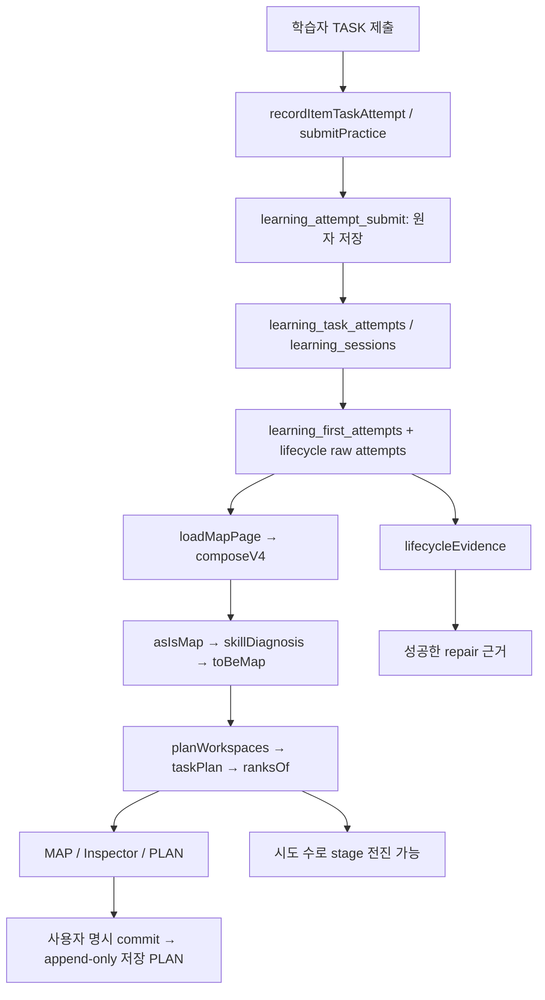

# LM-G1 — 최종 목표 Gap Audit

2026-10-15 · 구현 전 감사 · **최종 제품 목표는 부분 완료**. PC 화면 수용이나 Factory 계약 수용과 제품 전체 완성을 구별한다. 이번 변경은 문서와 읽기 전용 증거·합성 검증뿐이다.

## 1. 기준과 증거 경계

- 검토 main: `e33f08da7792300c699f9055861cde650d362bae` (PR #268 병합). 교육 기준은 [v6.2 CANON](LEARNING_MAP_V6_2_CANON.md). 기존 30개 TASK ID·코드북·NeedRank/ActionRank·composeV4·기출분석·공장 계약을 보존한다.
- GitHub 조사: [PR 이력](lm-g1/pr-history.json). #249 TASK 동작/연구, #251 reasoning·노출, #255 R5 재사용, #264 Factory 초기 계약, #267 PC UX, #268 UX 보완이다. 현재 main에는 Factory v1.1/v1.2 후속 수정도 포함된다. #264 최초판만을 현행 계약으로 평가하지 않는다.
- 선행 독립 수용: PM4b `7c0ff5b058789522d95b6ac4a83878771bd4a713`는 PC UX 범위 ACCEPT, Factory v1.2 `9733a7003`은 계약 수용이다. 저장 PLAN 복귀·교육 효과·실제 공장 연결의 수용으로 확대하지 않는다. 선행 FAIL/반례 원장은 변경하지 않았다.
- [DB SELECT](lm-g1/db-query.sql)·[집계/카탈로그 결과](lm-g1/db-snapshot.json)·[B/C 정확한 테이블명 조회](lm-g1/db-pending-exact.json)는 2026-10-15 관측이다. 개인 식별자·응답 전문은 보관하지 않았다. 카탈로그/집계 SELECT만 실행했고, 로더 호출·DB/RPC/RLS 적용·데이터 쓰기는 하지 않았다.
- [83개 테스트 결과](lm-g1/tests.json), [4개 관찰](lm-g1/probes.json). 8개 순수 함수/계약 suite가 PASS했다. 관찰 테스트 PASS는 발견된 미완료 조건이 사라졌다는 뜻이 아니다. 실제 사용자·브라우저 쓰기 E2E는 이번에 실행하지 않았다.
- 코드 경로의 기준 루트는 `apps/web/src/`이다. 테스트 계정·합성 기록을 실제 학습자 표본으로 사용하지 않았다. 효과·필요 총학습량·점수 상승량은 미확정이다.

## 2. 목표 대비 증거 행렬

차원은 서로 대체하지 않는다. **DESIGN_CLOSED**는 의미/판정 계약, **PRODUCT_INTEGRATED**는 현재 제품 연결, **SUPPORT_COVERED**는 해당 목표 범위를 실행할 도구·자료, **LEARNING_EFFECT_VALIDATED**는 실제 학생의 효과 검증이다. 마지막 차원의 공통 상태는 아래 모두 **검증 부족**이다. 설계 완료도 효과 증거가 아니다.

| ID · 최종 목표에서의 역할 | DESIGN_CLOSED | PRODUCT_INTEGRATED | SUPPORT_COVERED | LEARNING_EFFECT_VALIDATED |
|---|---|---|---|---|
| G1 목표 시험·점수/등급·일정·시간 예산의 버전 기준 | 부분 완료 | 부분 완료 | 부분 완료 | 검증 부족 |
| G2 시험기록의 적격성과 직접 TASK 수행 증거 분리 | 부분 완료 | 부분 완료 | 부분 완료 | 검증 부족 |
| G3 목표 관련성·확인 필요·실행 가능성 분리 | 완료 | 부분 완료 | 부분 완료 | 검증 부족 |
| G4 TASK별 정성 도달 조건·정량 계획량 근거 | 부분 완료 | 부분 완료 | 부분 완료 | 검증 부족 |
| G5 R5 FIND→REPAIR→TRANSFER→CHECK의 다음 행동 | 부분 완료 | 부분 완료 | 부분 완료 | 검증 부족 |
| G6 미노출 독립 확인·전이·지연·루브릭 결속 | 부분 완료 | 부분 완료 | 부분 완료 | 검증 부족 |
| G7 유효 수행→동일 학생 MAP/NeedRank/PLAN 갱신 | 완료 | 부분 완료 | 부분 완료 | 검증 부족 |
| G8 저장 PLAN·목표 버전·권한·멱등·실패 보존 | 부분 완료 | 부분 완료 | 검증 부족 | 검증 부족 |
| G9 V2/S5/E3의 실제 교수·평가 지원 | 부분 완료 | 부분 완료 | 부분 완료 | 검증 부족 |
| G10 기출·설명·Workspace·공장 실사용 연결 | 부분 완료 | 부분 완료 | 외부 입력 대기 | 검증 부족 |

G3/G7의 완료는 기존 계산 책임 분리의 설계에 한정한다. 세부 단계 준비 조건은 G5, 전체 목표 표현은 G1에 미완료로 남긴다. G9의 부분 완료는 E3 일부 실행과 V2/S5 준비 계약의 합이며, V2/S5 직접 평가가 구현됐다는 뜻이 아니다.

## 3. 연결이 있는 곳과 끊기는 곳

쓰기 어댑터나 재계산기를 처음부터 새로 만들 필요는 없다. 가장 먼저 확인된 단절은 **같은 수행 기록의 다음 단계 준비 조건이 두 경로에서 달라지는 것**이다. `v4/plan.ts::doneOf`는 학습량 진행을 세고 `stageNow`는 그 수로 전진한다. `lifecycle-evidence.ts::lifecycleEvidence`는 성공한 repair를 별도로 요구한다. G02에서 실패 재시도 2건 후 PLAN은 transfer, lifecycle은 repair였다.

시도 수를 정답 수로 바꿔 진행률을 왜곡해서는 안 된다. 진행량과 다음 행동 준비 조건을 분리해 후자를 같은 정책으로 결속하는 것이 첫 작업이다. 현재 CHECK 정책의 `resolved`도 보존한다. 독립 확인에서 이미 수행을 보인 학생에게 전체 교수 순서를 강제하지 않는다. 다만 `resolved`만으로 교수 경로 완주·전이·지연 유지까지 입증했다고 표시할 수 없다.

## 4. 요구별 근거·공백·최소 변경

### G1 — 목표의 실제 저장 범위

- 근거: `lib/csat/map/v62/target-spec.ts::targetSpecOf`, `v4/definition.ts::ToBeGoal`, `v4/plan-store.ts::setGoal`, GoalBar 및 `/api/csat/diagnosis/map/goal`. 현재 UI/어댑터는 score 중심이다. `setGoal`은 grade/exam/date를 null로 전달한다. G04는 examScope/grade/targetDate/timeBudget 미저장을 재현한다.
- DB: `csat_map_goal`·`csat_map_goal_version`와 RPC `csat_map_goal_set`은 **설치됨**. nullable grade/exam/date와 버전 구조는 재사용 가능하다. 전체 TargetSpec이 저장된 것은 아니다. score 필수 조건과 등급만 있는 목표의 의미도 별개다.
- 공백/위험: 목표 시험 범위를 실제 자료 선정·관련성 계산에 결속하지 못하면 화면상의 목표와 계획의 기준이 다를 수 있다. 시간 예산·복합 시험 범위의 영속화 및 과거 버전 해석이 없다. 높은 제품 위험, G3/G8 의존.
- 최소 변경: 기존 열을 읽고 쓰는 API·adapter·TargetSpec 연결부터 구현한다. 점수/등급 변환을 예측으로 만들지 않는다. 시간 예산/등급 단독 목표 등 기존 스키마 밖 요구는 SQL 차이와 이관 정책을 별도 승인받는다. 작업 LM-G1.3.

### G2 — 시험 이력과 직접 수행의 적격성

- 근거: `lib/knowledge/find-outcome.ts`, `prior-help.ts`, `lib/csat/map/load.ts::loadFindAttempts`, `skill-diagnosis.ts`; user_id 필터와 첫 시도·도움·phase 조건을 재사용한다. 시험 기록은 목표 맥락/노출 판단이고 문항 정오를 모든 TASK 직접 수행으로 복제하지 않는다.
- 실제 시험 이력 경로: `loadLearnerSessions`는 `csat_dx_session`/`csat_dx_response`와 `csat_exams.diagnosis_ready`를 읽고 `recordQuality`/`isDiagnosable`을 적용한다. `v4/as-is.ts`는 응시/입력 시각이 기준 시각 뒤이면 after_as_of, 부적격/미준비이면 not_diagnosable/exam_not_ready로 제외한다. `loadMapPage`의 현재 목표 참고 풀은 KICE·보류 제외·정답키를 거친 `selectReferenceExams`이며 전체 TargetSpec scope 소비와 다르다.
- 공백/위험: 과거/현재 시험의 범위·동일 지문·학습 열람·루브릭 버전까지 포함한 통합 적격성의 실제 학생 경로 검증은 부족하다. 시험 노출과 anchor 기반 TASK 확인을 하나의 능력치로 합치면 오판 위험이 높다.
- 최소 변경: 현재 writer/first-attempt 정책을 유지하고, 항목별 inclusion/exclusion reason과 판정 버전을 기록·설명한다. 동일 지문 식별과 exposure 결속은 G6과 함께 검사한다. 작업 LM-G1.2/4; 현재 RPC 재사용 자체에는 새 DB 승인이 필요 없다.

### G3 — 중요도와 실행 가능성

- 근거: `v4/to-be.ts`, `v62/rank.ts::ranksOf`, `coverage.ts`, `workspace.ts`, UnifiedLearningMap/TaskInspector. NeedRank와 ActionRank는 이미 다르다. G01은 직접 수행 모양의 입력 변화가 `verified_need`/REPAIR로 재계산됨을 확인한다.
- 공백/위험: 전체 TargetSpec을 반영한 중요도, 평가 미지원과 학생 약점의 구별을 실제 목표별로 검증해야 한다. G5의 잘못된 다음 단계는 ActionRank에도 전달된다. 미지원 TASK를 무관 또는 약점으로 처리하면 안 된다.
- 최소 변경: 랭커 재구현 없이 준비 조건과 목표 scope 입력만 연결하고, unknown/지원 부족 이유를 보존한다. LM-G1.1/3; DB 변경 불필요(추가 목표 영속화 제외).

### G4 — 도달 조건과 계획량

- 근거: `v4/plan.ts`, workspace 정의·v6.2 coverage의 확인/연습/전이 역할. 고정된 소규모 확인/연습 수는 제품 운영량이며 학생별 필요 총학습량이 아니다. 학습량 진행은 시도 수로 표시할 수 있다.
- 공백/위험: 모든 TASK의 정성 수행 루브릭·목표별 도달 판단은 확정되지 않았다. 기존 2회 등 기준의 학습 효과·최적량은 미검증이다. 시도 완료를 도달로 해석하면 교육적 위험이 높다.
- 최소 변경: count 근거를 운영 규칙/자료 제약/실증 결과로 구별하고, 단계별 수행 조건 및 충분성 한계를 노출한다. 자동 총량/점수 상승 추정은 추가하지 않는다. LM-G1.4; 새 증거 스키마 필요 시 승인 차이를 분석한다.

### G5 — R5의 수직 경로

- 근거: `lifecycle-evidence.ts::{lifecycleEvidence,nextLifecycleAction}`, `v4/plan.ts::{doneOf,taskPlan}`, `v4/workspace.ts::planWorkspaces`; G02 반례. 기존 claim-support 확인·practice route와 자료 선택기를 재사용한다.
- 공백/위험: 진행량 충족과 성공 근거가 갈라져 다음 행동이 일치하지 않는다. 첫 blocker이며 공장 설치와 무관하다. 이전 R5 6/6 브라우저 결과는 경로 일부 수용이지 실패→수정→전이→재확인 전체의 현행 수용이 아니다.
- 최소 변경: 공통 준비 조건을 적용하되 실패 시도량도 그대로 센다. 기존 최소 성공 정책을 명시하고 다른 정책을 도입하면 버전으로 분리한다. LM-G1.1 다음 LM-G1.2; 기존 R5 writer 재사용에는 새 DB 승인 불필요.

### G6 — 독립성·전이·지연 확인

- 근거: `skill-diagnosis.ts::skillDiagnosisOne`, `prior-help.ts`, practice 후보 선택·읽기 필터. 기존 독립 CHECK와 120일 만료 규칙이 있다. G03은 repair/transfer 기록 없이 뒤의 두 독립 정답으로 resolved가 됨을 재현한다. **120일은 지연 간격이 아니라 유효 창**이다. `skillMessage(resolved)`의 “처음 확인 뒤 연습하고”는 현재 판정 함수가 요구하지 않는 이력을 암시하므로 실제 이력에 조건부로 표시해야 한다.
- 공백/위험: 이 상태는 현행 CHECK 판단이지 교수 완주/지연 유지의 증거가 아니다. source presentation·공유 지문·현재 annotation·instrument/rubric/policy 버전을 모든 기록에서 재검증하는 계약과 지연 최소 간격이 부족하다. CHECK 직전 열람·새 창·동일 지문도 반례에 포함해야 한다.
- 최소 변경: 현재 상태를 소급 취소하지 않고 독립 확인/교수 경로 완료/전이/지연 성과를 따로 판정한다. 지연 간격은 검증된 최적값으로 주장하지 말고 정책을 먼저 고정한다. LM-G1.4. JSONB 확장 가능성부터 조사하고 RPC/RLS/스키마 변경은 승인 전 시행 금지.

### G7 — 실제 저장에서 MAP/PLAN으로

- 근거: `/api/csat/item/[slug]/task`→`product-server.ts::recordItemTaskAttempt`; `/api/csat/practice/attempt`→`practice-server.ts::submitPractice`→`practice-writer.ts`. 기본 writer는 `learning_attempt_submit` 원자 RPC이며 legacy/direct는 명시적 별도 경로다.
- 읽기: `loadMapPage`→`loadFindAttempts`의 `learning_first_attempts` 및 lifecycle raw 조회→`composeV4`→상태/요구/Workspace/PLAN/랭크. ClaimPractice의 다음 동작은 router.refresh, 지도 페이지는 dynamic이다. raw lifecycle 조회의 최근 1,000건 한도도 장기 이력 판정의 경계로 검증해야 한다.
- 공백/위험: 순수 재계산은 G01로 확인했으나 실제 동일 학생의 원자 저장→새 요청→UI와 저장 PLAN의 관계는 이번에 실행하지 않았다. `loadMapPage`는 decision log를 쓰므로 읽기 전용 DB 감사에서 호출하지 않았다.
- 최소 변경: 전체 어댑터를 새로 만들지 않고 G5 수정 뒤 실제 쓰기 수용 시나리오를 수행한다. 새 근거는 현재 상태/추천을 갱신하고 저장 PLAN의 순서/수량은 `applySaved`로 유지한다. 새 PLAN 버전은 명시 commit이며 자동 덮어쓰지 않는다. LM-G1.2; 테스트 데이터 쓰기는 이번 감사 범위 밖이다.

### G8 — 저장 버전·권한·실패 처리

- 근거: `v4/plan-store.ts`, `plan-commit.ts`, `v62/return-ctx.ts`, goal/plan API, plan-retry/store/return-ctx 테스트. DB workspace/plan·goal version·원자 commit RPC가 설치돼 있고 사용자 SELECT RLS, service-only 쓰기 권한을 확인했다. snapshot의 workspace/plan 행은 각각 0이다. 설치와 실사용 검증을 구별한다.
- 공백/위험: 실제 저장 PLAN 복귀는 **검증 부족/선행 NOT_TESTED 유지**. DB의 goal_version_id를 history adapter가 충분히 전달하지 않아 옛 PLAN의 기준 설명이 제한된다. 과거 URL은 최신 상태+변경 안내로 복귀하는 계약이며 옛 목표로 자동 되감지 않는다.
- 멱등 경계: API는 같은 키의 다른 본문을 충돌 처리한다. service-only RPC의 재요청 방어와 API 방어는 같은 층이 아니다. RPC에 payload signature까지 추가하는 방어는 선택적 승인 변경이며 R5 첫 blocker가 아니다.
- 최소 변경: 읽기 metadata 보강과 기존 append-only restore/충돌/권한 E2E를 재사용한다. rollback 시 기존 PLAN 보존, 타인 workspace 차단, 이전 목표 표시를 검사한다. LM-G1.2/3; 기존 열 읽기는 DB 승인 불필요, RPC 변경은 필요.

### G9 — V2/S5/E3 지원

- 근거: `lib/knowledge/item-tasks.ts`, `v62/inventory.ts`, `coverage.ts`, workspace 정의. V2/S5는 content_needed와 계약이 있으나 TASK 직접 확인 도구가 없다. E3의 option-restate는 제한된 문장/선지 근거 과제이며 완전한 5선지 판정 루브릭과 동일하지 않다.
- 현재 자료: DB active claim-support 9개 기본/4개 transfer 표시, evidence-locate 5, option-restate 6 및 일부 draft를 관측했다. 이 수는 실제 적격 미노출 지문 수가 아니다. 현재 annotation/anchor/skeleton/출처·중복·노출 필터를 통과해야 한다. 숫자를 조합해 지원 완료로 승격하지 않는다.
- V2 DCP vocab_choice는 `/dev/vocab-practice` 개발 경로의 어댑터다. DCP 기록과 G2 TASK 직접 증거의 저장 경로는 다르다. A3 grader 확장만으로 V2/S5 평가가 생기지 않는다. S5 전체 범위는 vocab_choice로 대체할 수 없다.
- 최소 변경: V2와 S5를 별도 instrument·루브릭·TASK 연결·현재 적격 자료·저장 적격성으로 수용한다. E3도 현행 범위를 표시한다. LM-G1.5; 새 자료 생성/공개/DB 적용은 이 감사에서 하지 않는다.

### G10 — 기출·교수·공장·Workspace

- 근거: `v62/{research,study-items,supply,supply-ledger,factory-integration}.ts`, Factory v1.2 계약, 공개 v3 링크. 현재 설명/연구·확인 과제 링크는 재사용 가능하다. 운영 검수와 인간 교육 타당도 검증을 구별한다.
- 공백/위험: Factory는 **MOCK_ONLY / NOT_CONNECTED**. 인터페이스·형식 계약이 수용됐어도 실제 주문·생산·manifest·신뢰 승인 reader·공급 시점 learner exposure 검증은 완료가 아니다. 테스트 교재는 실제 상품으로 승격할 수 없다.
- DB: A 관련 새 practice RPC/분류 열과 A3 vocab_choice grader 분기는 미적용 상태를 확인했다. B의 demand/order/delivery 5개, C의 qualification/release/revocation 3개 실제 이름 모두 없다. 기존 PLAN 저장 설치와 B 미설치를 혼동하지 않는다.
- 최소 변경: 기존 R5에 A3/A/C/B를 선행 강제하지 않는다. Factory 실제 연결은 별도 브랜치로 유지하고 승인 SQL·권한·reader·실제 manifest가 준비될 때만 진행한다. LM-G1.6; 지금은 외부 입력 대기다.

## 5. 판정과 다음 구현 경계

**재사용:** 30 TASK·composeV4·Need/Action 분리·원자 수행 writer·첫 시도/도움 필터·기존 R5 과제/연습·append-only PLAN/goal 버전·현재 UI·Factory 안전 계약. 재구현하지 않는다.

**확정 미완료:** 다음 단계 준비 조건 일치, 실제 동일 학생 전체 수직/저장 복귀 수용, 전체 목표 표현·버전 연결, 수행 기준/노출/지연 계약, V2/S5 직접 도구 및 E3 범위 확대, 실제 Factory 연결. 실제 학습 효과는 별도 실증 전까지 검증 부족이다.

첫 Claude 작업은 LM-G1.1이다. 정확한 파일 범위·순서·DB 승인 분리는 [완료 로드맵](TARGET_COMPLETION_ROADMAP.md), 성공/실패/권한 반례는 [R5 수직 수용](R5_VERTICAL_ACCEPTANCE.md)에 고정했다. 이번 감사가 제품 구현 완료를 승인하지는 않는다.
