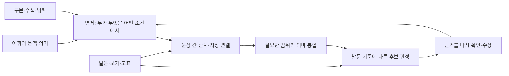

# 수능 영어 독해의 본질과 방법론 — 연구 보고 v0.1

기준: 2026-10-12. **연구 정본 최종판이 아니라 입력 감사·독립 파일럿·이론 비교에 근거한 탐색 보고**다. 774문항의 저장 입력과 기존 자산을 감사했으며, 전 문항의 9축 의미 분류·최근 연도 확인적 검증·인간 전문가 검수·학습자 실험 완료를 주장하지 않는다. 완료 범위와 다음 확대 조건은 [실행 계획](./PLAN.md), 실제 분모는 [감사](./AUDIT.md), 최초 분류·불일치는 data/ 원장에 둔다.

주장의 층위를 O(직접 관찰), L(문항 논리의 재구성), H(연구 가설), G(조건부 일반화 후보), E(교수 효과)로 구분한다. 공식 정답표 확인은 정답 출처의 증거이며 특정 해설·교수법의 옳음까지 보장하지 않는다. 공식 출제 방향과 개별 출제자의 심리·의도도 구분한다.

## A. 본질 정의

현재 증거가 허용하는 **작업 정의(H/G)**는 다음과 같다.

> 영어 독해는 언어 표현과 자료에서 주체·행위·조건·범위를 갖춘 의미를 구성하고, 필요한 문장 간 관계를 연결하여 글이 제시하는 내용과 관점을 일관되게 이해하는 과정이다. 수능의 읽기 문항은 여기에 발문이 요구하는 기준을 적용해 후보 답의 성립 여부를 판별하는 과제를 결합한다.

두 부분을 분리해야 한다. 글을 이해하는 데 필요한 언어·인지 처리는 시험 밖에도 존재한다. 시험은 목적 판별, 정보 대조, 압축, 문맥 의미, 배열, 구문 정확성, 수치 관계 등 서로 다른 산출을 요구한다. 문항 풀이에 충분한 일부 근거와 글 전체를 충분히 이해했다는 증거는 같지 않다. 특히 어법은 문장 형식의 정확성, 순서·삽입·요약은 공식 안내에서 간접 쓰기와도 관련되는 과제이므로 보유 자료의 `읽기 in_scope`를 순수 읽기 능력 하나의 시험으로 재명명하지 않는다.

이 과제 구분은 [평가원 2023학년도 학습 방법 안내](https://www.jne.go.kr/upload/jinro/na/bbs_395/ntt_5042031/doc_7d745d0e-7f3b-435a-a040-bcab2fd06af61653a2669b48838.pdf)의 영어 평가 목표(본문96쪽)와 비교했다. 교육청 공식 보관본의 발행 표지·해시와 해당 절을 직접 확인했다. 이 공식 안내는 평가 목표와 권장 학습 내용을 설명하지만, 해당 교수법의 독립 효과 실험이나 개별 문항 출제자의 실제 사고 기록은 아니다. 2026학년도 안내 본문 직접 확인은 아직 미완료다.

어휘·문법·읽기의 관계는 [Jeon–Yamashita 메타분석](https://onlinelibrary.wiley.com/doi/10.1111/lang.12034)의 상관 증거와 부합하는 분석틀이다. 의미 구성의 언어 관계는 [Kintsch–Mangalath](https://onlinelibrary.wiley.com/doi/10.1111/j.1756-8765.2010.01107.x)의 이론 모형, 통합된 상황 표상은 [Zwaan–Radvansky](https://memorylab.nd.edu/assets/257368/zwaan_radvansky_1998_psychological_bulletin_.pdf)의 리뷰와 비교한다. 이 출처들은 현재 수능 문항의 타당도나 제안 교수법의 효과를 직접 검증한 자료가 아니다. 1988 CI 원논문의 본문 직접 확인 수준은 SOURCES.md에 별도 표시한다.

**대립은 관계의 하나이며 현재 증거로 독해 전체의 본질이라고 정의할 수 없다.** 물고기 배송 광고(2014A#23), 작가 약력의 제목 사실 확인(2019#26), 운영 일정 공지(2023#27), 주어·대명사의 대상 식별(2014A#44)은 서로 다른 결정 근거를 갖는다. 대립이 있는 2019#29에서도 어법상 답은 수동태와 대동사 관계로 판단하며 두 독립 분류자는 대립 단독을 insufficient, 국소 구문을 applicable로 판정했다. 이는 탐색적 논리 반례 후보이며 학생에게 대립을 가르치는 효과 자체를 반증한 것은 아니다.

빈도가 높은 관계가 가장 중요한 능력이라는 결론도 보류한다. 출제 편집 비율, 지문 선정, 반복 본문, 과제 수, 미수집 모평, 보류 편향이 관찰 빈도에 영향을 줄 수 있다.

## B. 사고 구성요소 체계

다음은 **분석상의 연결 구조**이며 학생 뇌에서 언제나 같은 순서로 실행되는 직렬 과정이라는 주장이 아니다.

| 구성 요소 | 공통 분석 질문 | 달라지는 중요도/예외 | 파일럿 근거 |
|---|---|---|---|
| 어휘 | 이 문맥의 낱말이 어떤 뜻·대상을 가리키는가? | 어휘 문제는 낱말의 극성과 관계가 직접 판정 대상. 모든 낱말의 사전 정의를 말할 필요는 없음 | 2017#29, 2022#42 |
| 구문 | 주체·정동사·수식·절·부정/양화의 범위는 어디인가? | 어법에서는 국소 관계만으로 정답이 정해질 수 있음. 전체 논지는 추가 언어 이해 대상 | 2019#29 |
| 명제 | 누가 무엇을 하며 무엇이 어느 조건에서 참인가? | 정보 일치는 시점·주체·수량의 보존, 요약은 추상화 후 의미 보존이 중요 | 2019#26, M2006#26, 2017#40 |
| 관계 | 앞뒤 단위는 예시·인과·조건·재진술·비교·순서 중 무엇으로 연결되는가? | 표지어는 단서이며 관계 자체가 아님. 대조와 양보도 구분 | M2206#36, 2023#37, 2014B#37 |
| 통합 | 글의 중심 내용·범위·위계와 사건 연결은 무엇인가? | 모든 유형에서 동일한 전역 통합량을 요구하지 않음. 일부 정보 대조는 국소 근거로 충분 | 2020#23, 2019#24, 2021#43 |
| 추론 | 직접 표현을 잇는가, 빠진 연결을 보충하는가, 문맥 의미를 정하는가? | 근거의 공간 범위(local/global)와 과정 성격(contextual)을 혼동하지 않음 | 2022#21, M2106#31 |
| 과제 판정 | 발문이 요구하는 답은 사실의 참/거짓인가, 가장 알맞은 압축인가, 결속 위치인가? | 선지 내용이 참이어도 제목/목적 요구를 못 채울 수 있음. 틀린 표현을 고르는 문제는 공식 선택답이 잘못된 표현 | 2024#25, 2020#38, 2019#29 |

### 실제 원문에서 드러나는 연결의 차이

아래 L 표기는 연구자의 탐색적 논리 재구성 후보이다. 독립 분류자의 최초 결과와 source 상태를 대조하기 전에는 확인된 반례로 승격하지 않는다. 2024#25는 두 분류자와 연구 총괄이 실제 PDF 도표를 직접 확인했다. 이 개별 확인을 파일럿 전체 원문 검증 완료로 확대하지 않는다.

- **2014B#37(L)**: 자원 자체는 기후 변화에 쉽게 바뀌지 않지만 접근·탐사 조건은 바뀐다. 첫 칸은 대상과 조건의 차이를 연결하고 두 번째 칸은 시베리아 사례를 연결한다. ‘대립 하나 찾기’만으로 두 칸의 요구를 모두 충족했다고 할 수 없다.
- **2020#23(L 후보·전략 불일치)**: 유전과 환경 중 하나를 택하는 해석은 글의 상호작용 결론과 다르다. 그러나 A는 ‘단순 유전 결정론과 상호작용 설명’의 대비를 사용해 대립 전략이 적용 가능하다고, B는 유전 대 환경을 찾는 것만으로 부족하다고 판정했다. 대비할 명제의 차원을 고정하지 않으면 같은 글을 지지와 반례로 모두 분류할 수 있다는 방법 결함이 드러났다. 이 사례를 합의된 전략 반례로 쓰지 않는다.
- **2017#40(L 후보·전략 불일치)**: 주민 반응은 다양하며 조건이 있다. 한쪽의 우월성으로 압축하면 범위를 바꾸지만, A와 B는 대립 단독의 충분성에 달리 답했다. 두 분류자 모두 핵심문장 단독은 적용 가능하다고 판정했다. 요약 유형이므로 항상 여러 문장이 필요하다고 일반화하지 않는다.
- **M2206#36(L)**: 실험 절차→관찰된 비대칭→그 결과의 의미를 잇는다. B의 지시 대상은 C의 결과이고 A는 결과를 얻은 절차다. 단락 순서는 표지어 하나보다 선행 내용의 필요 조건으로 판정해야 한다.
- **2014A#44(L)**: 같은 공유 지문에 여러 여성이 나오므로 대명사의 화자·행위자·관계 연결이 중요하다. 지문의 감동적 주제와 대명사 판정은 별개의 과제이다.
- **2024#25(L, 직접 시각자료 확인 필요)**: 나라·연도·수치·전칭 범위를 맞춘 뒤 불일치를 고른다. Finland의 하락을 Japan에도 적용한 표현을 실제 값과 대조한다. 대립을 이야기로 해석하는 과정이 숫자 대조를 대신하지 못한다.

이 사례는 서로 다른 읽기 과제를 비교하는 표본이다. 32문항의 목적 표집으로 모든 과제의 발생 비율이나 연도별 변화를 추정하지 않는다.

## C. 10년 이상 기출 분석 결과와 확인 수준

2014~2026학년도 본시험14책자와 보유 모평14책자, 총774문항의 **입력·유형·연도·기관 분포**를 계산했다. 범위 밖28문항(M2706)을 제외했다. 연구 범위의 공개 v3는758개이고16개는 기존 보류다. 연도별·유형별 표는 AUDIT.md와 원시 manifest에서 재현한다.

공유 지문은690개 후보 그룹으로 분리했으며, 5개 장문 그룹에서 저장 본문 버전 차이가 있고 2014 A/B에는 동일 본문3쌍이 있다. 따라서 774를 지문수로 쓰지 않고 후보 그룹·동일 본문 군집·출제 사건을 별도 유지한다. 아직 전체 후보의 원문 확정이 끝나지 않아690을 독립적으로 검증한 고유 지문수라고 보고하지 않는다.

**전 기간의 담화 종류·추론 범위·정답 근거 구조 분포는 아직 미확정**이다. 저장된 유형별로 이를 자동 채워 넣지 않았다. 파일럿의 최초 독립 분류와 축별 일치도는 data/pilot-a.json, pilot-b.json, pilot-agreement.json의 완성 제출본으로 보존한다(실행 중 초안은 완성 결과로 세지 않음). 확대 여부는 사전 기준과 원문 상태를 함께 적용한다. 파일럿의 전체 원문 결속 문제가 해결되지 않은 축에는 확인적 전수 확대를 하지 않는다.

기존749비교쌍 중 연구 범위 양쪽 문항만 사용하는 쌍은325개다. 같은 구조에 집중된 비교 자료를 그대로 반례 검증 자료라고 해석할 수 없다. 110조건부 원리 객체 중 양쪽이 연구 범위인 객체는51개다. 이는 기존 AI가 작성한 원리 후보이며 이번 연구의 독립 검증을 통과한 원리 수가 아니다.

### 독립32문항 파일럿 결과

두 별도 AI 문맥의 공식답 비공개 첫 완성 제출본32개, 공유지문 후보30개에서 계산했다. 같은 모형 설정을 상속했으며 학습 데이터 미노출을 보장하지 않는다. 일부 중간 초안의 미보존과 제출 전 스키마 정리 이력은 EXCEPTIONS 및 execution-record에 기록했다. 최초 완성본은 hash로 동결했고 조정본으로 덮지 않았다. 빈 코드/판단 불능 처리·출처 및 hash 가드 등은 등록 후 보완한 v1.0.1 실행 규칙으로, 완성 제출본과의 정확한 시간 순서가 미입증인 부분은 사전 등록으로 소급하지 않는다. 2024#25의 PDF 도표 추가 입력도 예외로 명시했다.

| 축 | 최초 판정 일치 | 지표 | 확대용 수치 기준 |
|---|---:|---|---|
| 담화 목적 | 30/32 =93.75% | Cohen κ=0.913 | ≥80% 통과 |
| 평가 요구 | 31/32 =96.88% | Cohen κ=0.965 | ≥80% 통과 |
| 문장 관계 | 평균65.25% | 다중코드 Jaccard | ≥70% **실패** |
| 추론 | 평균83.07% | 다중코드 Jaccard | ≥70% 통과 |
| 대립 전략 | 27/32 =84.38% | 상태 exact, κ=0.750 | 수치 기준 통과 |
| 핵심문장 전략 | 31/32 =96.88% | 상태 exact, κ=0.904 | 수치 기준 통과 |
| 직독직해 전략 | 31/32 =96.88% | 상태 exact, κ=0 | 수치 기준 통과·변별 증거 부족 |
| 구문 전략 | 29/32 =90.63% | 상태 exact, κ=0.368 | 수치 기준 통과·범주 편중 |
| 선택적 읽기 전략 | 32/32 =100% | 모두 applicable, κ 정의 불가 | 수치 기준 통과·변별 증거 없음 |

일치율은 정답률·전략 성공률·효과크기가 아니다. 두 분류자의32답 모두 DB 저장 정답과 같았지만, 공식답 출처와 교수 효과의 검증은 별개다. 29문항에서 주요 축 또는 전략의 일부 불일치가 남아 최초 결과를 그대로 보존했다. 여러 관계 중 한 코드가 더 붙은 차이도 불일치에 포함된다. 지지/반례의 결론이 같다는 의미로 합의 처리하지 않았다.

표 밖의 명제·언어 복잡성 코드도 pilot-agreement에 보존했다. 예를 들어 명제 object의 이진 κ는 약0.29, polarity는 약0.32, 언어 복잡성 scope는 약0.33으로 일부 코드의 안정성이 낮다. 보기 성립160쌍은153쌍 일치(95.63%, κ=0.942)이며 사후 보완 계산·문항 내 종속 관찰이다. 코드가 일치해도 사실의 참·거짓과 과제 적합성을 혼동한 판단이 옳아지는 것은 아니다. 설계 재구성의 내용 타당성 및9축 전체의 검수 완료를 주장하지 않는다.

고정 seed·지문 군집 bootstrap1,000회로 기술적 구간을 계산했다(원시 담화 일치83.9~100%, 관계 Jaccard57.9~72.6%). 목적 표집이므로 이 구간을 전체 수능·미래 시험의 모집단 신뢰구간으로 해석하지 않는다. 전체 교차표·코드별 이진 일치·결측·최초 답은 pilot-agreement.json에 있다.

**확인적 확대는 허용하지 않았다.** 관계 축이 수치 기준에 실패했고, PDF 텍스트 선별 대조32/32·해당형 정답표 텍스트 일치27/32·시각 확인7/32는 원문 전체 대조 완료가 아니다. source-audit의 전체 제시문/보기·정답 계보 확인 완료는0/32이며5문항의 보완 정답표 원본 PDF도 미확보다. 단순한 숫자상 일치만으로774문항의 관계·전략 분포나 검증된 독해 원리를 작성하지 않는다. 첫 파일럿이 밝힌 분류 안정성과 source 결함이 이번 연구 결과의 일부다.

다음 코드북 보완 후보는 관계를 글 전체/정답 결정 연결로 구분하고 각 관계에 두 단위와 방향을 붙이는 것, 핵심문장/대립의 허용 입력과 충분성의 경계, 선택적 읽기의 실제 읽은 범위를 기록하는 것이다. 100% 선택적 읽기 상태 일치는 범위 확대가 허용된 정의가 지나치게 포괄적일 가능성도 함께 검토해야 한다. 수정 후 새 미열람 발견 표본이 필요하다.

정답 공개 후 B가 자기 최초 결과만 재검토한 기록은 pilot-post-key.json에 별도로 보존했다. 32답은 모두 같지만 15문항에 코드·보기 판단·전략 충분성의 정정 후보가 있다. 특히 함축 의미 문항의 평가 요구, 문법·지칭·삽입 후보의 과제 적합성과 진릿값 혼합, 미언급 감정을 ‘원문과 모순’으로 판정한 과장이 드러났다. 이는 답을 맞혔다는 사실만으로 분석이 타당하다고 할 수 없다는 증거다. 최초 일치도를 재계산하거나 정정 후보를 합의 판정으로 승격하지 않았다.

문항의 어휘 길이·구문 길이·3점 여부·유형 차이는 계산/관찰할 수 있으나 **문항 난도나 필요한 인지능력의 인과적 크기**로 해석하지 않는다. 국내 이독성 연구도 선정 표본·중복 지문·EBSi 자발 응답이라는 제한을 갖는다([Kim–Jung, 2025](https://journal.kci.go.kr/meeso/archive/articlePdf?artiId=ART003173986)). 현 연구에는 공식 문항별 응답 분포와 독립 학생 과정 자료가 없다.

## D. 독해 방법론의 성립 조건과 반례

여기서 ‘적용 가능’은 원문·발문·보기 사이의 논리적 설명이 가능하다는 뜻이다. 학생의 실제 속도·정확도 향상이라는 성공 지표는 측정하지 않았다. 각 전략의 독립 실행 범위는 PROTOCOL.md에 고정했다.

| 전략 | 타당한 사용 조건(G 후보) | 반례/한계(L) | 현재 근거 수준 |
|---|---|---|---|
| 대립 찾기 | 실제로 대비되는 명제의 같은 차원·대상·범위를 확인하고, 그 대비가 발문 판정에 연결될 때 | 2020#23은 유전 대 환경의 양자택일을 거부. 2019#29는 대립이 있어도 어법 답은 대동사/수동. 2023#27은 일정 전칭 대조가 결정적 | 사례 논리; 전수 적용률·교수 효과 미확정 |
| 핵심문장 찾기 | 선정한 한 문장이 요구 내용을 충분히 담고 모든 경쟁 보기를 배제할 때 | 2020#19의 감정 변화는 전후 사건, 2021#43은 사건의 연쇄. 2017#40에서는 두 분류자 모두 한 문장 전략을 적용 가능으로 판정해 요약 유형 전체를 반례로 묶지 않음 | 한 문장 충분성 후보; 표본 밖 재현 필요 |
| 직독직해 | 제시 순서에서 절의 의미·지시 대상·범위를 누적하고 뒤 정보로 초기 해석을 고칠 때 | 한국어 어순대로 직역만 쌓으면 M2206#36의 제시 순서가 실제 순서가 아님을 처리하지 못함. 어휘의 첫 사전 뜻과 형태 번역이 문맥 의미를 보장하지 않음 | 분석상 유용한 의미 갱신 절차; 속도 효과 미측정 |
| 구문독해 | 정동사·태·수식·절·부정 범위가 판정에 결정적일 때; 어휘 의미와 결합 | 2019#29에서는 직접적. 2019#24의 제목 압축, 2023#37의 단락 결속은 한 국소 구문의 해부만으로 충분하지 않음 | 국소 필요 조건의 사례; 전 유형 만능법 아님 |
| 선택적 읽기 | 발문이 특정 대상/수치/조건을 지정하며 읽은 근거가 경쟁 보기 전체를 대조할 만큼 충분할 때 | M2006#26의 크기 표현은 근거 항목 대조 가능. 삽입/순서/전체 범위 판정에서 연결이 미해결이면 읽는 범위를 넓혀야 함. 일부만 읽었다는 사실과 충분성은 별개 | 조건부 탐색 정책; 시간 이득 미측정 |

‘빠르게 읽는다’, ‘핵심만 읽는다’는 행동이 구체적으로 정의되지 않으면 반증할 수 없다. 처음에 국소만 보고 실패한 뒤 전체를 읽어 맞혔다면 부분 읽기 단독 성공으로 소급하지 않는다. 반례를 피하려고 적용 조건을 나중에 늘리는 것도 새 원리 버전으로 기록한다.

강사·교재 공식 소개에는 논리를 이용한 예측과 문법·구문에 기초한 정확한 문장 해석 등이 제시된다(SOURCES.md). 소개문과 목차를 읽은 수준이며 강의 전체의 방법을 평가한 것은 아니다. 판매량·유명세·홍보상의 속도 향상 주장은 효과 증거로 사용하지 않았다. 기존 주장을 이 연구의 원문 사례와 비교할 수 있지만 강사 개인의 전체 방법론이 반증되었다고 표현하지 않는다.

## E. 학습자용 교수 모델 — 효과 검증 전 가설

**교수 설계 가설(H/E 미검증)**: 학생이 표현을 해석하는 데서 끝내지 않고 ‘의미를 보존하며 필요한 관계를 연결하고, 과제 조건으로 확인’할 수 있도록 가르친다. 다음은 교육 내용의 층위이며 실제 풀이 중 매번 여섯 단계의 강제 관문을 통과하라는 지시가 아니다.

1. **문맥 속 어휘와 절 이해**: 낱말의 문맥 뜻, 주어·행위·대상을 짧게 설명한다. 길고 어려운 문장은 의미에 결정적인 구문만 확대한다.
2. **명제의 정확성**: 누가 무엇을 하는지, 부정·시점·조건·정도·양화가 어디에 걸리는지 학생이 자기 말로 표현한다. 주체/범위를 바꾼 문장과 대조한다.
3. **앞뒤 관계**: 두 명제 사이의 ‘왜/예를 들면/다시 말하면/이것은 무엇인가/어떤 조건에서’를 명시한다. 표지어 이름만 찾는 답보다 연결 내용을 설명하게 한다.
4. **글 전체 의미의 통합**: 중심 내용, 이를 지지하는 사례, 한정 조건, 서사 인물·사건을 구분해 짧게 요약한다. 같은 본문에 다른 문항을 붙여 글의 이해와 과제 판정을 구분한다.
5. **발문과 다섯 보기의 대응**: 내용 참/거짓/근거 없음과 ‘이 발문에 답하는가’를 따로 판정한다. 대표적인 경쟁 보기의 바뀐 주체·조건·범위를 찾은 뒤 나머지 보기도 확인한다.
6. **조건부 전략과 다른 기출의 대조**: 이번에 충분했던 읽기 범위와 다른 사례에서는 부족한 이유를 함께 남긴다. 같은 표현+다른 관계, 다른 소재+같은 제약을 모두 비교한다.

교사의 설명 예: M2006#26에서는 두 지역이 각각 기준 크기라는 의미를 두 지역의 합으로 바꾸면 틀린 이유를 보여 준다. 2019#29에서는 문장의 의미와 태/대동사 제약을 연결한다. 2020#23에서는 ‘대립 표현이 있으므로 둘 중 하나가 답’이라는 초기 모델을 상호작용 모델로 수정한다. 학생이 표현을 그대로 따라 한 것은 새 지문을 이해했다는 증거가 아니다.

글 구조 교수의 근거는 있으나 수능·한국 EFL로의 전이를 자동 인정하지 않는다. [Hebert 등(2016)](https://files.eric.ed.gov/fulltext/ED648909.pdf)은 설명문 구조 지도 연구를 종합하면서 평가와 지도 내용의 거리 및 일반 독해로의 전이 한계를 다룬다. Vocaflow의 효과는 별도 검증해야 한다.

검증 설계: 숙련도/어휘·문법 사전 수준을 층화하고 동일 시간·동일 자료의 비교 교수에 무작위 배정한다. 사전 학습하지 않은 권리 확보 문항에서 근접 전이·다른 소재/유형 전이·지연 유지, 정확도·시간·설명 근거·도움 사용을 별도 측정한다. 정오 변화만으로 명제 통합 능력 향상이라고 해석하지 않는다. 학생 과정과 점수 주장의 연결은 [ECD](https://files.eric.ed.gov/fulltext/ED480557.pdf) 관점에서 각각 검증한다. 표본크기·주요 결과·제외 기준은 학생 실험 전에 등록해야 한다.

## F. Vocaflow 적용 제안 — 연구 결과와 별도

이번 연구에서 UI·공개 데이터·DB를 바꾸지 않았다. 아래는 연구가 제공할 수 있는 개선 가설이며 구현 승인이나 학습 효과의 입증이 아니다.

| 재사용할 자산 | 연구가 요구하는 보완 | 학습자에게 보여 줄 관계 | 확인 전 상태 |
|---|---|---|---|
| v3 원문 의미·구조·관계 장면 | 시험 제시문, 복원한 글, 문항별 표시 변형과 공통 passage ID를 분리 | 빈칸 채우기/순서 복원 전후에 무엇이 바뀌는지 | 장문5그룹 입력 차이 확인; 전량 source binding 감사 필요 |
| v3 발문·보기 판정 | 내용 성립과 발문 충족을 별도 필드; false와 unsupported를 구분; 전칭/부정 범위 근거 | 같은 내용이 참이어도 제목 범위를 못 채울 수 있는 이유 | 독립 파일럿 판정과 기존 v3 불일치를 보존 후 검수 |
| sentence/unit 연결 | 문장·절·표/도표 셀·삽입 위치·순서 단락에 맞는 근거 단위, 원문 버전/hash 결속 | 선택한 근거와 연결 대상의 실제 의미 | 16보류 기존 공개 상태 유지; 임의 번호 보정 금지 |
| 비교749쌍/원리110객체 | 범위 밖 상대 구별, 같은 지문 반복 군집, 실패/조건외 사례를 추가 | ‘어디까지 통하고 왜 여기서는 부족한가’ | 기존 AI 검수는 연구 타당도와 별도 |
| 강의 설명/자기 설명 과제 | 관찰·문항 논리·설계 가설·교육 효과의 층위 분리; 중간 의미 갱신 제시 | 주체/범위·관계의 변화와 후보 배제 | 공식 기록 없는 출제 의도를 사실처럼 말하지 않음 |
| 도움과 이해 확인 기록 | 답 맞힘·설명 열람·자기 설명·미학습 문항 전이를 구별 | 학생이 이번에 확인한 관계와 다음 도움 | 실제 학생 실험 전 성과 라벨/자동 추천 효과 보류 |

운영 run/hash를 학습자 화면에 노출하는 대신 검증 층이 사용한다. 학생에게는 실제 관계와 근거 수준을 설명한다. 기존 공개 v3를 덮거나 원문을 재배포하는 방식으로 연구 결속 문제를 우회하지 않는다.

## 남아 있는 판단

이 보고서가 지지하는 것은 공통 의미 처리와 과제별 판정의 구분이라는 작업 모형, 전략을 조건부로 기술할 필요, 원문·검수 수준의 엄격한 구분이다. 전 유형에 필요한 능력의 상대적 크기, 특정 관계의 전수 비율, 최근 연도 재현 성공률, 교수법 우열·학습 효과, 개별 문항의 실제 출제 의도는 현재 확정하지 않는다. 후속 자료와 반례가 작업 정의를 수정할 수 있다.
